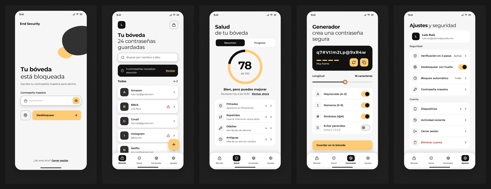
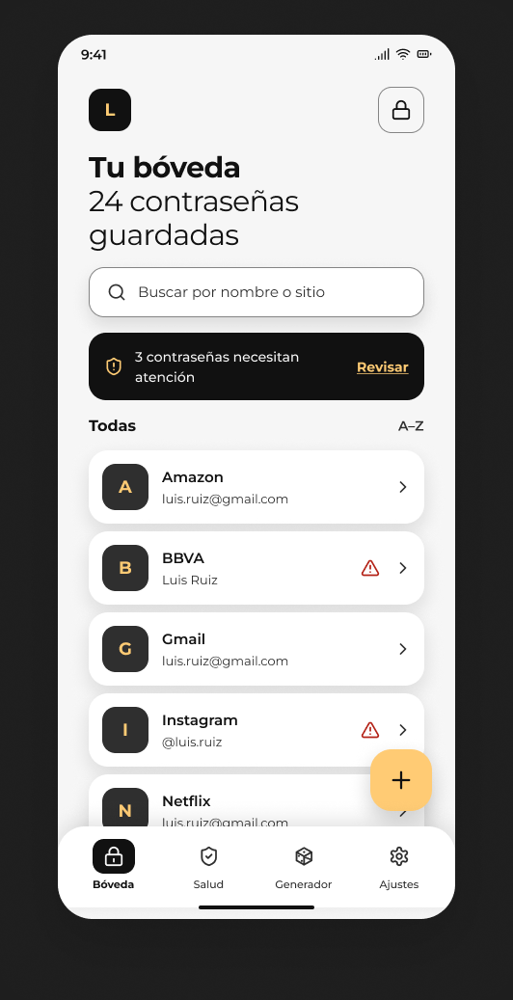
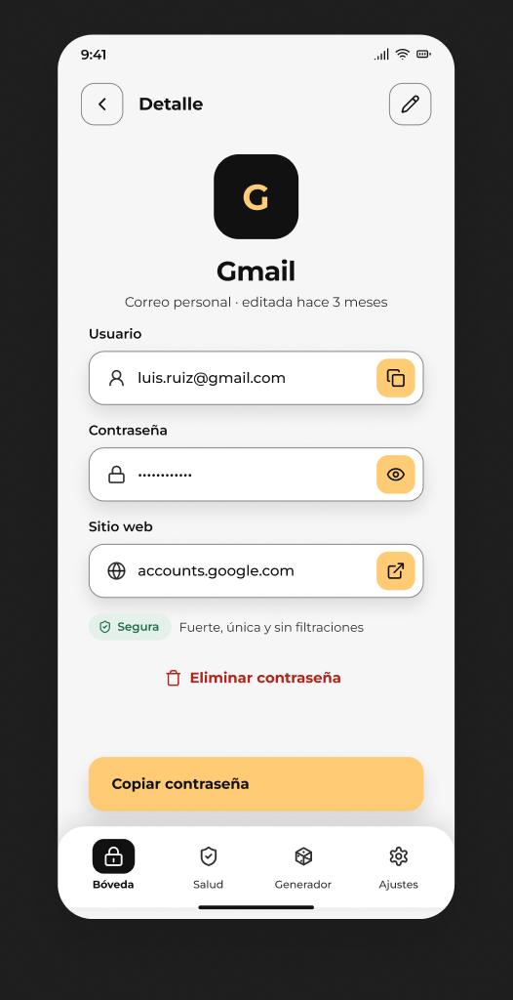
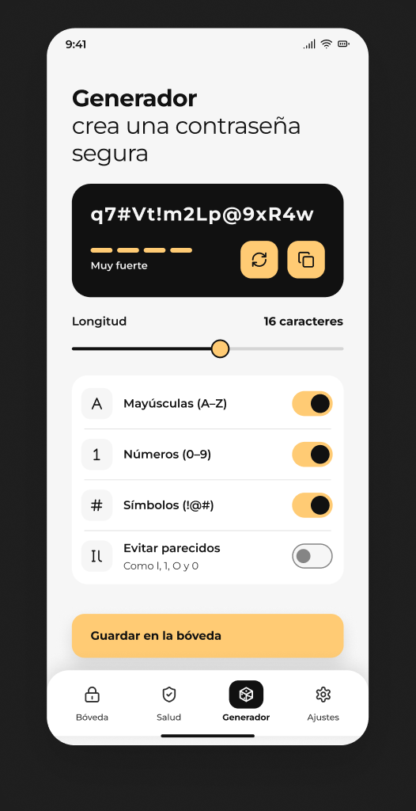
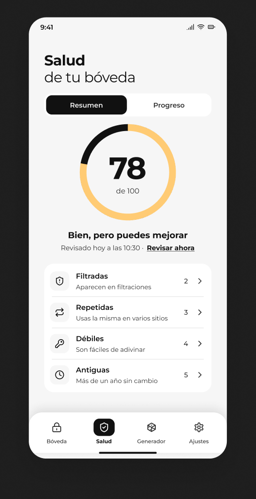
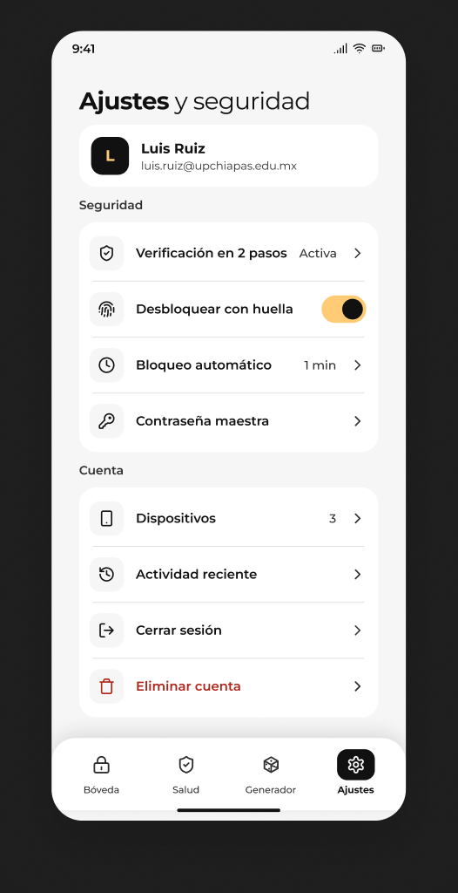
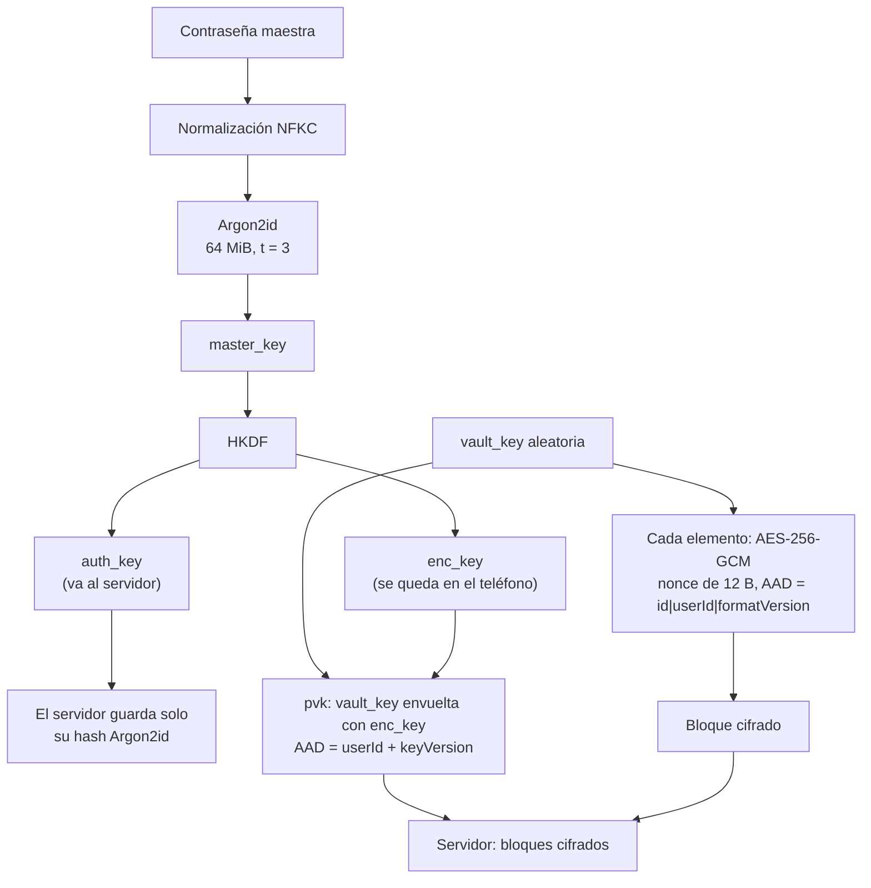
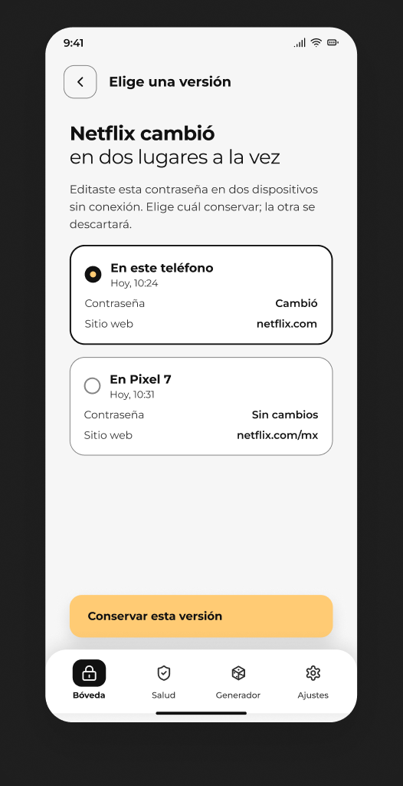

# End Security

Gestor de contraseñas para Android en el que el servidor nunca puede leer tus contraseñas.

    

<p align="center"></p>

Este repositorio es **la app Android**. El servidor está en [end-security-backend](https://github.com/Diego-Zarate18/end-security-backend).

---

## Problema que resuelve

- **Reutilizar contraseñas** es lo más común y lo más peligroso: una filtración abre todas las cuentas.
- **No saber cuáles están filtradas**: nadie revisa a mano si una contraseña apareció en una brecha.
- **Muchos gestores piden confiar en su servidor**: si el servidor se compromete, tus contraseñas también.
- End Security cifra todo en el teléfono y solo sube bloques ilegibles.

---

## Responsabilidades principales de la app

- **Cifrado y llaves en el teléfono:** derivación de llaves, cifrado de cada elemento y bloqueo de la bóveda.
- **Bóveda sin conexión con sincronización:** todo funciona sin red; los cambios se suben al reconectar.
- **Salud de contraseñas:** índice de salud, contraseñas débiles, repetidas, parecidas y filtradas.
- **Acceso:** verificación en dos pasos (TOTP y códigos de respaldo), huella y bloqueo automático.
- **Cuenta y legal:** cambio de correo y de contraseña maestra, dispositivos, actividad, eliminación de cuenta, aviso de privacidad y términos.

<p align="center">
  
  
  
  
  
</p>

---

## Lo que el servidor nunca ve



**El servidor recibe:**

- bloques cifrados (los elementos y la `vault_key` envuelta);
- la sal y los parámetros de Argon2id;
- el hash de la `auth_key` (nunca la contraseña maestra);
- metadatos: cantidad de elementos, tamaños de bloque y fechas.

**El servidor no recibe:**

- tus contraseñas, usuarios ni nombres de sitios;
- la contraseña maestra ni la `enc_key`;
- el análisis de salud (qué contraseñas son débiles, repetidas o parecidas).

---

## Flujo general

- **Registro:** la app deriva las llaves y envía solo la `auth_key`.
- **Verificación:** el correo se confirma con un código.
- **Desbloqueo:** contraseña maestra o huella; la `vault_key` vive solo en memoria.
- **Bóveda y sincronización:** altas, cambios y lápidas; el servidor guarda versiones y la app resuelve conflictos.
- **Salud:** el análisis se hace en el teléfono; las filtraciones se consultan por k-anonimato.
- **Cierre o eliminación:** cerrar sesión bloquea y limpia la memoria; eliminar la cuenta borra los datos locales y los del servidor.

---

## Estructura interna

Código en `app/src/main/java/com/luis/end_security/`, con arquitectura MVVM y flujo unidireccional ([docs/arquitectura.md](docs/arquitectura.md)). Regla de dependencias: `ui → domain ← data`.

| Carpeta | Para qué sirve |
|---|---|
| `core/crypto` | Único lugar con código criptográfico (Argon2id, HKDF, AES-GCM, generador) y `keystore/` para Android Keystore |
| `core/session` | Estado bloqueado/desbloqueado y `vault_key` en memoria |
| `core/sync` | Motor de sincronización y resolución de conflictos |
| `core/network` | Contrato con el backend, renovación de token de una en una |
| `core/security` | FLAG_SECURE, portapapeles seguro y autobloqueo |
| `core/designsystem` | Tema y componentes reutilizables |
| `feature/*` | `auth`, `unlock`, `vault`, `health`, `twofactor`, `account`, `activity`, `settings` |

**Base de datos local (Room):**

- `account`: la cuenta de este teléfono y sus llaves envueltas.
- `vault_items`: los elementos como bloques cifrados, con su versión y lápida.
- `breach_checks`: caché cifrada del resultado de las consultas de filtraciones.
- `health_snapshots`: historial cifrado del índice de salud, para la pantalla de progreso.

Diagrama de la base de datos: [docs/bd](docs/bd/modelo-datos.md).

---

## Comunicación con otros servicios

- **Backend propio:** contrato en [docs/api/openapi.yaml](docs/api/openapi.yaml) (versión 1.4.0). Lo que falta para la integración real está en [docs/api/brechas-backend.md](docs/api/brechas-backend.md).
- **Have I Been Pwned:** consulta por **k-anonimato**; se envían solo los primeros 5 caracteres del SHA-1 y se pide relleno, así que ni siquiera esos 5 caracteres identifican una contraseña.
- **Resend (correo):** solo lo usa el backend; la app nunca habla con él.
- **Sin analítica ni publicidad.**

---

## Decisiones técnicas

- **Conflictos por versión del servidor y elección del usuario, no por la hora.** Los relojes de los teléfonos no son confiables; así nunca se pisa un cambio sin que la persona lo decida.
- **Sin recuperación de la contraseña maestra.** Recuperarla exigiría que alguien más pudiera abrir la bóveda; es el precio del conocimiento cero.
- **Índice de salud = porcentaje de contraseñas sanas, con tope si hay filtradas.** Un 100 % con una contraseña filtrada sería engañoso.
- **Contraseñas parecidas solo en memoria.** Comparar contraseñas entre sí exige descifrarlas; el resultado no se guarda ni sale del teléfono.
- **La huella nunca abre sola.** Se pide explícitamente al tocar el botón, para que un desbloqueo accidental no exponga la bóveda.
- **Variantes `demo` y `prod`.** `demo` incluye un backend simulado y local; `prod` no contiene ese código y quedará lista al integrar el servidor real. Así el APK publicado nunca puede mostrar códigos de verificación de un servidor que no existe.

<p align="center"></p>

---

## Modelo de amenazas

**Protege contra:**

- **Servidor comprometido:** solo tiene bloques cifrados; no puede leer ni modificar elementos sin que falle la autenticación de AES-GCM.
- **Intercepción de red:** HTTPS con fijación de certificado (pinning) y, además, todo viaja ya cifrado de extremo a extremo.
- **Robo de la base de datos** (del servidor o del teléfono): los bloques están cifrados con una llave que no se guarda.
- **Capturas de pantalla:** las pantallas con secretos usan FLAG_SECURE.
- **Portapapeles:** se marca como sensible y se limpia solo a los 30 s.

**No protege contra** (riesgos aceptados en el grafo de decisiones, `RSG-*`):

- **Teléfono con root** (RSG-05): puede leer la memoria.
- **Olvido de la contraseña maestra** (RSG-08): no hay recuperación, se pierde la bóveda.
- **Metadatos que ve el servidor** (RSG-01): cantidad de elementos, tamaños y fechas.
- **Fuerza bruta offline** (RSG-03): con una base de datos robada, solo frenan Argon2id y la fortaleza de la contraseña maestra.
- **Contraseña del generador en accesibilidad** (RSG-15): se expone en la descripción para que TalkBack la lea; un servicio de accesibilidad malicioso podría leerla.

---

## Pruébalo en 2 minutos

La versión de demostración **no necesita servidor**: el backend es simulado y todo vive en tu teléfono.

- Descarga el APK de la release [`v1.0.0-demo`](https://github.com/MrX-zeta/End-Security/releases/tag/v1.0.0-demo) e instálalo (puede pedirte permitir orígenes desconocidos).
- Crea una cuenta con cualquier correo: el **código de verificación aparece en pantalla** («Modo demostración · Código»).
- Para probar la verificación en dos pasos, crea una cuenta con `+2fa` antes de la `@` (por ejemplo `ana+2fa@correo.com`). Los datos de prueba (clave TOTP y códigos de respaldo) son públicos y están en [docs/api/backend-falso.md](docs/api/backend-falso.md).

---

## Desarrollo local

**Requisitos:**

- Android Studio compatible con AGP 9.2.1;
- JDK 17 o superior (sirve el que trae Android Studio);
- Android SDK 37.

```bash
git clone https://github.com/MrX-zeta/End-Security.git
cd End-Security
git checkout development
./gradlew :app:assembleDemoDebug
```

**Firmar una release:** crea en la raíz un `keystore.properties` (no se versiona) con las cuatro claves `storeFile`, `storePassword`, `keyAlias` y `keyPassword`, y corre `./gradlew :app:assembleDemoRelease`. Sin ese archivo, la release se compila **sin firmar**.

---

## Pruebas

- **Unitarias: 1064** (variante `demo`; la variante `prod` corre 920 más 3 propias que comprueban que no lleva el backend falso).
- **Instrumentadas (Compose y dispositivo): 365**, en un emulador.
- Las pruebas de la UI usan reloj controlado y comprueban posiciones y tamaños, no capturas.

```bash
./gradlew testDemoDebugUnitTest
./gradlew lintDemoDebug
ANDROID_SERIAL=emulator-5554 ./gradlew connectedDemoDebugAndroidTest
```

- Lo sensible (criptografía, sesión, autenticación, SQL) pasó por una **revisión de seguridad** independiente antes de darse por terminado.
- **Límite conocido (E3):** el portapapeles se limpia solo, pero la prueba en dispositivo debe repetirse con «Enable clipboard sharing» desactivado en el emulador; ver [ai/handoff/revisiones-pendientes.md](ai/handoff/revisiones-pendientes.md).

---

## Cómo se construyó

- **Diseño en Figma.**
- **Una sesión de diseño (Claude)** mantiene el grafo de decisiones (`ai/context`) y escribe cada tarea (`ai/handoff`).
- **Claude Code** implementa cada tarea, con pruebas.
- **Un subagente de revisión de seguridad** revisa el código sensible.
- **Revisión humana** de lo marcado en [ai/handoff/revisiones-pendientes.md](ai/handoff/revisiones-pendientes.md).

La IA asistió en el diseño y en el código. Las decisiones, la revisión y las pruebas en el dispositivo son del equipo.

---

## Relación con el sistema y estado

- **Terminado en esta app:** cifrado, bóveda, sincronización, salud, dos pasos, cuenta y legal, funcionando contra el backend simulado.
- **Pendiente:** la integración con el backend real ([docs/api/brechas-backend.md](docs/api/brechas-backend.md)).
- Llegará como **`v1.1.0`**, con la variante `prod`.

---

## Equipo

- Brian Luis Ruiz Pérez
- Diego Alberto Zárate Vázquez

Proyecto académico de la **Universidad Politécnica de Chiapas**, sin fines comerciales.

- [Aviso de privacidad](docs/legal/aviso-de-privacidad.md)
- [Términos y condiciones](docs/legal/terminos-y-condiciones.md)

**Créditos:** lista de contraseñas filtradas de [Have I Been Pwned](https://haveibeenpwned.com) (CC BY 4.0) y tipografía Montserrat (SIL OFL).

**Licencia:** Todos los derechos reservados (proyecto académico).
